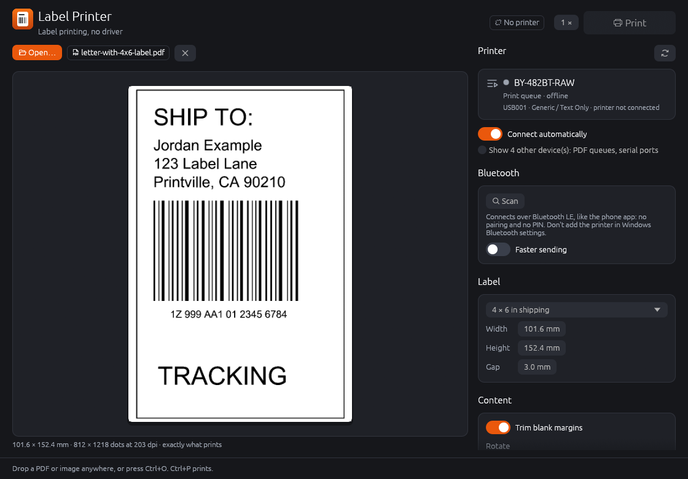
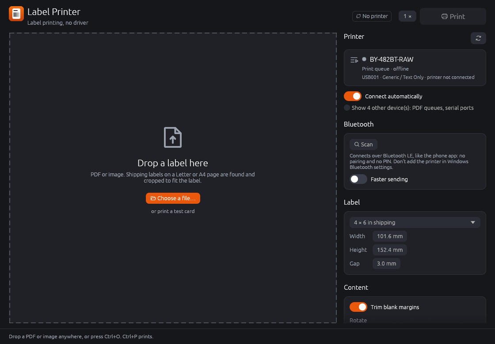

# Label Printer


> [!WARNING]
> **This only works with one printer: the PEDOOLO BY-482BT.** It is the only
> printer this has been built and tested against. Other TSPL label printers
> may work, but nothing else has been tried, and printers that speak other
> languages (ZPL, ESC/POS, …) will not work. Use it with any other printer at
> your own risk.

> [!NOTE]
> **Windows is the only tested platform.** Linux and macOS builds are
> published with every release and pass the automated tests, but they have
> never been tried with a real printer. Reports are welcome.

Print shipping labels and other PDFs or images on TSPL thermal label printers
(PEDOOLO / BEEPRT BY-482BT and similar) **with no printer driver at all**:
not the vendor's, and not Windows' *Generic / Text Only* either. The app talks
to the printer directly over USB or Bluetooth LE.



## Features

- **No driver, no setup.** Plug the printer in with USB and it is found and
  connected by itself, straight through the USB printer support built into
  Windows. Or connect over Bluetooth LE with no pairing and no PIN.
- **Reconnects by itself.** Remembers the last printer (USB or Bluetooth) and
  picks it up again on start, or when it is switched on or plugged in later.
- **PDFs and images.** A 4×6 shipping label on a Letter or A4 page is found,
  cropped and rendered at the printer's 203 dpi. Text and barcodes stay sharp;
  photos are dithered. Multi-page PDFs print in one go.
- **Exact preview.** What you see is what prints, dot for dot.
- **Printer tools.** Label presets, darkness and speed, Feed label, Calibrate.
- **One file.** The PDF renderer is built into the executable; nothing is
  downloaded at install or run time.

| Nothing open yet | What gets printed |
| --- | --- |
|  |  |

## Install

Downloads are on the
[Releases](https://github.com/Jordan-Dev-Stuff/Label-Printer/releases) page.
Every download is self-contained: nothing else is installed or downloaded.

| Platform | Download | Status |
| --- | --- | --- |
| Windows 10/11 (x64) | `Label-Printer-<version>-setup.exe`, or the `windows-x64-portable.zip` | Tested |
| Debian, Ubuntu, Mint, Pop!_OS (amd64) | `Label-Printer-<version>-linux-amd64.deb` | Untested |
| Fedora, openSUSE (x86_64) | `Label-Printer-<version>-linux-x86_64.rpm` | Untested |
| Other Linux (x86_64) | `Label-Printer-<version>-linux-x86_64.AppImage` | Untested |
| macOS 11+ (Apple Silicon and Intel) | `Label-Printer-<version>-macos-universal.zip` | Untested |

**Windows.** Run the installer. It installs for the current user (no
administrator prompt) and can add *Print with Label Printer* to the
right-click menu of PDF files. Or unzip the portable zip and run
`label-printer.exe`.

**Linux (untested).** Both packages need glibc 2.35 or newer: Ubuntu 22.04+,
Debian 12+, Mint 21+, Fedora 36+, Arch and other rolling distributions. RHEL 9
and openSUSE Leap 15 are too old.

- **`.deb` (Debian, Ubuntu, Mint, Pop!_OS):** open it with your software
  installer, or run
  `sudo apt install ./Label-Printer-<version>-linux-amd64.deb`. It pulls in
  what it needs, adds Label Printer to the applications menu, and installs a
  udev rule so you can print over USB without root or joining a group.
- **`.rpm` (Fedora, openSUSE):** the same, for RPM-based systems. Open it with
  your software installer, or run
  `sudo dnf install ./Label-Printer-<version>-linux-x86_64.rpm` (Fedora) or
  `sudo zypper install ./Label-Printer-<version>-linux-x86_64.rpm` (openSUSE).
  A `.deb` does not install on Fedora, and an `.rpm` does not install on
  Ubuntu.
- **AppImage (any distribution):** make it executable and run it:
  `chmod +x Label-Printer-*.AppImage && ./Label-Printer-*.AppImage`. It uses
  the desktop's own libraries and file dialog (xdg-desktop-portal), which
  desktop distributions include. AppImages are now zstd-compressed, so tools
  that add them to the menu must support that: use
  [Gear Lever](https://flathub.org/apps/it.mijorus.gearlever) or
  AppImageLauncher 3. AppImageLauncher 2.x shows "Failed to register AppImage
  in system via libappimage", but the AppImage still runs. For USB printing,
  install the udev rule once (it ships inside the AppImage):

  ```bash
  ./Label-Printer-*.AppImage --appimage-extract usr/share/doc/label-printer/70-label-printer.rules
  sudo cp squashfs-root/usr/share/doc/label-printer/70-label-printer.rules /etc/udev/rules.d/
  sudo udevadm control --reload-rules && sudo udevadm trigger
  ```

USB printing uses the kernel's `usblp` driver (`/dev/usb/lp0`). If the printer
is not found, run `sudo modprobe usblp`. When you plug the printer in, your
desktop may offer to install a printer driver: you can ignore it, Label
Printer does not use one. Bluetooth printing needs BlueZ, which desktop
distributions include. The scan may show the printer twice; only the entry
ending in `-LE` works, and the app hides the other when both appear.
Dragging files onto the window may not work in Wayland sessions; use
**Choose a file…** instead.

**macOS (untested).** Unzip and drag *Label Printer* to Applications. The app
is not notarised by Apple, so the first time, right-click it and choose
**Open**. Allow Bluetooth when asked. macOS has no driverless USB route, so
connect over Bluetooth LE (or a CUPS raw queue).

### Connecting the printer

- **USB:** plug it in and switch it on. The printer card appears within a few
  seconds and the header turns green.
- **Bluetooth:** click **Scan** in the Bluetooth card, then **Connect**. Do
  *not* pair the printer in your system's Bluetooth settings: that uses
  Bluetooth Classic and asks for a PIN (usually `0000` or `1234`). The app uses
  Bluetooth LE, like the phone app, which needs no PIN. The printer is
  remembered and reconnected automatically next time.

## Command line

`tspl-rs` is installed next to the app:

```powershell
tspl-rs list                         # label printers found; --all for everything
tspl-rs print --target <target> --pattern testcard
tspl-rs print --target file:card.tspl --pattern testcard --compact
tspl-rs send  --target <target> --job captured.prn
```

Targets look like `usb:\\?\usb#vid_09c6&pid_0426#…` (copy it from `list`),
`raw:QueueName`, `serial:COM5` or `file:path`. See [docs/cli.md](docs/cli.md).

## Building

Requirements: Rust 1.88 or newer. Windows is the primary platform; Linux and
macOS build the same code.

```powershell
# once per build machine: the pinned PDF renderer that gets embedded
powershell -ExecutionPolicy Bypass -File scripts\fetch-pdfium.ps1   # or ./scripts/fetch-pdfium.sh

cargo build --release            # target\release\label-printer.exe and tspl-rs.exe
cargo test --all
```

The installer is built with Inno Setup 6:
`iscc /DAppVersion=0.3.1 installer\label-printer.iss`. Releases are built by
GitHub Actions when a `v*` tag is pushed. See
[docs/development.md](docs/development.md).

## Repository layout

```text
crates/
  tspl-core/       engine: TSPL encoder, frames, USB/serial/queue transports,
                   discovery (no third-party dependencies)
  tspl-cli/        `tspl-rs` command line tool
  label-printer/   desktop app (egui): preview, PDF rendering, Bluetooth LE
assets/            app icon (.ico embedded in the Windows exe, .png)
docs/              protocol reference, transports, architecture, development
installer/         Windows installer (Inno Setup)
packaging/         Linux .desktop entry, udev rule, .deb/.rpm scripts; macOS Info.plist
scripts/           fetch-pdfium.ps1 / .sh (build machines only)
vendor/pdfium/     fetched PDF renderer, embedded at build time (not committed)
```

## Documentation

| Document | Contents |
| --- | --- |
| [docs/protocol.md](docs/protocol.md) | **The printer protocol**: TSPL job bytes, bitmap polarity, USB `usbprint` access and the IEEE 1284 id, Bluetooth Classic vs LE, the PIN, GATT channels, pacing |
| [docs/transports.md](docs/transports.md) | How each connection works, discovery, failure modes and fixes |
| [docs/pdf.md](docs/pdf.md) | Embedded PDF renderer, two-pass rendering, limitations |
| [docs/ui.md](docs/ui.md) | The app: layout, auto-connect, threads, settings |
| [docs/architecture.md](docs/architecture.md) | Crates, data flow, design decisions |
| [docs/cli.md](docs/cli.md) | Command line reference |
| [docs/testing.md](docs/testing.md) | Test strategy and hardware checks |
| [docs/development.md](docs/development.md) | Building, CI, releasing |
| [docs/roadmap.md](docs/roadmap.md) | What is done and what is next |

## Platform support

| Capability | Windows | Linux | macOS |
| --- | --- | --- | --- |
| **Tested with a printer** | **yes** | no | no |
| Built and unit-tested in CI | yes | yes | yes |
| Direct USB, no driver | `usbprint.sys` | `/dev/usb/lp*` | — |
| Bluetooth LE | yes | yes | yes |
| Paired Bluetooth serial | `COMx` | `/dev/rfcomm*` | `/dev/cu.*` |
| RAW print queue (optional) | `winspool.drv` | `lp -o raw` | `lp -o raw` |

## License

MIT; see [LICENSE](LICENSE). The embedded PDF renderer is
[pdfium](https://pdfium.googlesource.com/pdfium/) (BSD-3-Clause), via
[pdfium-binaries](https://github.com/bblanchon/pdfium-binaries); its license
is installed as `LICENSE-pdfium.txt`.
