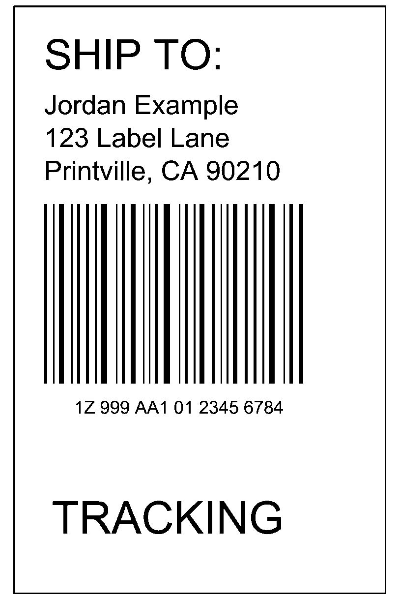

# Label Printer

> [!WARNING]
> **This only works with one printer: the PEDOOLO BY-482BT.** It is the only
> printer this has been built and tested against. Other TSPL label printers
> may work, but nothing else has been tried, and printers that speak other
> languages (ZPL, ESC/POS, …) will not work. Use it with any other printer at
> your own risk.

Print shipping labels and other PDFs or images on TSPL thermal label printers
(PEDOOLO / BEEPRT BY-482BT and similar) **with no printer driver at all**:
not the vendor's, and not Windows' *Generic / Text Only* either. The app talks
to the printer directly over USB or Bluetooth LE.


## Features

- **No driver, no setup.** Plug the printer in with USB and it is found and
  connected by itself, straight through the USB printer support built into
  Windows. Or connect over Bluetooth LE with no pairing and no PIN.
- **Reconnects by itself.** Remembers the last printer (USB or Bluetooth) and
  picks it up again on start, or when it is switched on or plugged in later.
- **PDFs and images.** A 4×6 shipping label on a Letter or A4 page is found,
  cropped and rendered at the printer's 203 dpi. Text and barcodes stay sharp;
  photos are dithered. Multi-page PDFs print in one go.
- **Exact preview.** What you see is what prints, dot for dot.
- **Printer tools.** Label presets, darkness and speed, Feed label, Calibrate.
- **One file.** The PDF renderer is built into the executable; nothing is
  downloaded at install or run time.

| Nothing open yet | What gets printed |
| --- | --- |
|  |  |

## Install

Download `thermal-rs-<version>-setup.exe` from
[Releases](https://github.com/Jordan-Dev-Stuff/Label-Printer/releases) and run
it. It installs for the current user (no administrator prompt) and can add
*Print label with thermal-rs* to the right-click menu of PDF files. A portable
zip is published alongside it.

### Connecting the printer

- **USB:** plug it in and switch it on. The printer card appears within a few
  seconds and the header turns green.
- **Bluetooth:** click **Scan** in the Bluetooth card, then **Connect**. Do
  *not* add the printer in Windows Bluetooth settings: that pairs over
  Bluetooth Classic and asks for a PIN (usually `0000` or `1234`). The app uses
  Bluetooth LE, like the phone app, which needs no PIN.

## Command line

`tspl-rs` is installed next to the app:

```powershell
tspl-rs list                         # label printers found; --all for everything
tspl-rs print --target <target> --pattern testcard
tspl-rs print --target file:card.tspl --pattern testcard --compact
tspl-rs send  --target <target> --job captured.prn
```

Targets look like `usb:\\?\usb#vid_09c6&pid_0426#…` (copy it from `list`),
`raw:QueueName`, `serial:COM5` or `file:path`. See [docs/cli.md](docs/cli.md).

## Building

Requirements: Rust 1.88 or newer. Windows is the primary platform; Linux and
macOS build the same code.

```powershell
# once per build machine: the pinned PDF renderer that gets embedded
powershell -ExecutionPolicy Bypass -File scripts\fetch-pdfium.ps1   # or ./scripts/fetch-pdfium.sh

cargo build --release            # target\release\thermal-ui.exe and tspl-rs.exe
cargo test --all
```

The installer is built with Inno Setup 6:
`iscc /DAppVersion=0.2.0 installer\thermal-rs.iss`. Releases are built by
GitHub Actions when a `v*` tag is pushed. See
[docs/development.md](docs/development.md).

## Repository layout

```text
crates/
  tspl-core/     engine: TSPL encoder, frames, USB/serial/queue transports, discovery
                 (no third-party dependencies)
  tspl-cli/      `tspl-rs` command line tool
  thermal-ui/    desktop app (egui): preview, PDF rendering, Bluetooth LE
docs/            protocol reference, transports, architecture, development
installer/       Inno Setup script
scripts/         fetch-pdfium.ps1 / .sh (build machines only)
vendor/pdfium/   fetched PDF renderer, embedded at build time (not committed)
```

## Documentation

| Document | Contents |
| --- | --- |
| [docs/protocol.md](docs/protocol.md) | **The printer protocol**: TSPL job bytes, bitmap polarity, USB `usbprint` access and the IEEE 1284 id, Bluetooth Classic vs LE, the PIN, GATT channels, pacing |
| [docs/transports.md](docs/transports.md) | How each connection works, discovery, failure modes and fixes |
| [docs/pdf.md](docs/pdf.md) | Embedded PDF renderer, two-pass rendering, limitations |
| [docs/ui.md](docs/ui.md) | The app: layout, auto-connect, threads, settings |
| [docs/architecture.md](docs/architecture.md) | Crates, data flow, design decisions |
| [docs/cli.md](docs/cli.md) | Command line reference |
| [docs/testing.md](docs/testing.md) | Test strategy and hardware checks |
| [docs/development.md](docs/development.md) | Building, CI, releasing |
| [docs/roadmap.md](docs/roadmap.md) | What is done and what is next |

## Platform support

| Capability | Windows | Linux | macOS |
| --- | --- | --- | --- |
| Direct USB, no driver | `usbprint.sys` | `/dev/usb/lp*` | — |
| Bluetooth LE | yes | yes | yes |
| Paired Bluetooth serial | `COMx` | `/dev/rfcomm*` | `/dev/cu.*` |
| RAW print queue (optional) | `winspool.drv` | `lp -o raw` | `lp -o raw` |

Windows is tested on hardware. Linux is built and unit-tested in CI; macOS is
expected to work but is untested.

## License

MIT; see [LICENSE](LICENSE). The embedded PDF renderer is
[pdfium](https://pdfium.googlesource.com/pdfium/) (BSD-3-Clause), via
[pdfium-binaries](https://github.com/bblanchon/pdfium-binaries); its license
is installed as `LICENSE-pdfium.txt`.
