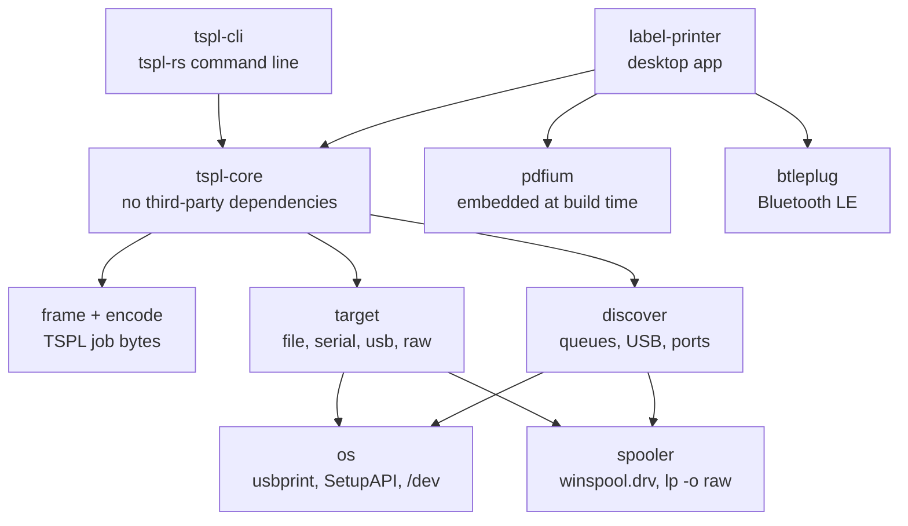

# Architecture

## Shape



`tspl-core` is the only crate that knows TSPL. Front ends never build command
strings; they hand the engine a [`Frame`](../crates/tspl-core/src/frame.rs) and
a [`Config`](../crates/tspl-core/src/encode.rs), receive a `Vec<u8>` job and
send it to a [`Target`](../crates/tspl-core/src/target.rs). Bluetooth LE is the
one transport outside the core: the app writes the core's job bytes to a GATT
characteristic.

## Crates

| Crate | Contents |
| --- | --- |
| `tspl-core` | Engine: frames, encoder, targets, discovery, platform device access |
| `tspl-cli` | `tspl-rs`: `list`, `print`, `send` |
| `label-printer` | Desktop app: UI, workers, PDF rendering, image preparation, Bluetooth LE, settings |

### `tspl-core` modules

| Module | Responsibility |
| --- | --- |
| `frame` | Grayscale buffer, thresholding, Floyd–Steinberg, test patterns |
| `encode` | `Config` validation and the TSPL job builder, including compact bands |
| `target` | `kind:value` parsing; file, serial, direct-USB and queue delivery |
| `spooler` | Platform RAW delivery: `winspool.drv` or `lp -o raw`, plus queue details |
| `discover` | Gathers queues, USB printers and ports; links, names, filters and ranks them |
| `os` | Device access: SetupAPI, registry and `usbprint` I/O on Windows; `/dev` and sysfs on Unix |
| `error` | One `Error` enum, `Display` + `std::error::Error` |

### `label-printer` modules

| Module | Responsibility |
| --- | --- |
| `app` | Window state, layout, auto-connect, settings save |
| `theme` | Palette, cards, toggles, chips, the app icon |
| `jobs` | Render-and-print worker: decode, render, encode, wired send |
| `pdf` | Embedded pdfium: unpack, load once, two-pass render |
| `content` | Crop, rotate, fit, place, halftone choice, PDF render plan |
| `devices` | Discovery watcher thread |
| `ble` | Bluetooth LE worker: scan, connect, channel choice, paced writes |
| `filter` | Which Bluetooth advertisers look like printers |
| `settings` | Persisted settings, presets, writable storage location |

## Data flow for one print

1. The app opens the file: an image is decoded to grey; a PDF page is
   rendered by pdfium at exactly the scale that makes its content fill the
   label (see [pdf.md](pdf.md)).
2. Content is cropped, turned and fitted to the label size in dots, then
   centred on a white frame.
3. The frame becomes pure black and white: a threshold for line art,
   Floyd–Steinberg for photos.
4. `encode` writes the TSPL job (header, `BITMAP` bands, `PRINT`); see
   [protocol.md](protocol.md).
5. The job goes to a `Target` (USB, queue, serial, file) on the render worker,
   or to the Bluetooth worker.

There is no intermediate file: the job is built in memory and written once.

## Design decisions

### No dependencies in the core

`tspl-core` uses only the standard library:

- The security surface stays small: hand-written FFI on Windows, one process
  spawn (`lp`, `lpstat`) on Unix.
- The engine can be embedded in another app, a service or a test harness
  without pulling in a GUI stack.
- It builds and tests offline.

The app crate is where heavier dependencies live (egui, image, pdfium-render,
btleplug, rfd, tokio).

### Hand-written Win32 bindings

The Windows surface is small and stable since Windows 2000: seven `Winspool`
functions, a handful from SetupAPI, two registry calls and `CreateFileW` /
`WriteFile` / `DeviceIoControl`. Declaring them directly avoids a versioned
bindings dependency. `unsafe` is confined to
[`spooler/windows_impl.rs`](../crates/tspl-core/src/spooler/windows_impl.rs)
and [`os/windows.rs`](../crates/tspl-core/src/os/windows.rs), handles are
closed by guards, and every call is checked.

### Platform selection by `cfg`

There is exactly one implementation per platform family, chosen at compile
time:

```rust
#[cfg(windows)]      mod windows_impl;  pub use windows_impl::{list_queue_details, list_queues, send_raw};
#[cfg(not(windows))] mod unix_impl;     pub use unix_impl::{list_queue_details, list_queues, send_raw};
```

A trait with one implementer per target adds a `dyn` boundary for no benefit.

### Discovery is pure where it matters

Platform code only gathers raw facts. Linking a queue to its USB device,
naming Bluetooth ports, hiding virtual queues and ranking candidates happen in
[`assemble`](../crates/tspl-core/src/discover.rs) and
[`best_printer`](../crates/tspl-core/src/discover.rs), plain functions tested
with recorded facts on any OS.

### Errors carry context, discovery never fails as a whole

Every I/O error names what failed (`write C:\temp\job.tspl: Access is denied.
(os error 5)`), and the app shows it verbatim. `discover()` returns printers
plus warnings, so one broken source never hides the others.

### Nothing slow on the UI thread

Three workers (discovery, render and print, Bluetooth) talk to the UI over
channels and wake it when they post. See [ui.md](ui.md#threads).

## Extending

| Task | Where |
| --- | --- |
| New TSPL command | `encode.rs`, plus a test in `tests/encode.rs` and [protocol.md](protocol.md) |
| Compressed raster | New encoder path selected by a `Config` field |
| New transport | `Target` variant + `target::send`, plus [transports.md](transports.md) |
| New discovery source | Platform code in `os/`, facts into `assemble` |
| New Bluetooth printer family | Its write UUID in `KNOWN_WRITE_UUIDS` (`ble.rs`) |

## Deliberate non-goals

- **A printer driver.** The point is to avoid one.
- **Bidirectional status.** Needs a read path (`~HS`, USB bulk-in) that no
  feature needs yet.
- **Printer-side fonts and barcodes.** Host rendering keeps output identical
  across firmware revisions.
