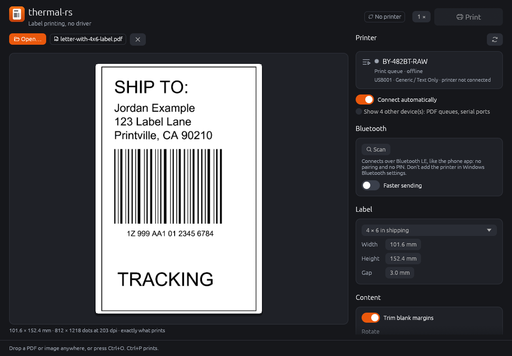
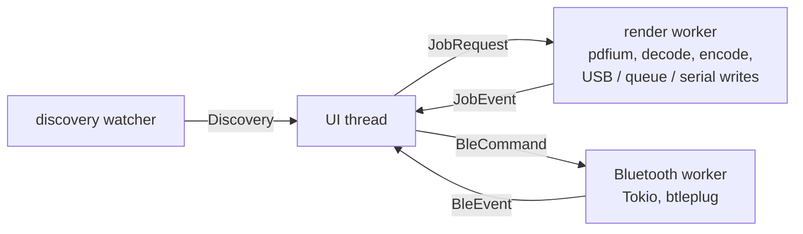

# Desktop app

`thermal-ui` is an `eframe`/`egui` app: dark `#16171B` background, rounded
cards, Phosphor icons, accent-filled primary buttons and slide toggles, with a
thermal-orange accent. It is a thin shell over `tspl-core`; every print uses
the same encoder and transports as the CLI.



## Layout

| Area | Contents |
| --- | --- |
| Header | App mark, connected-printer chip (also spelled out in words), copies, **Print** |
| Centre | With nothing open, a drop zone (click it to choose a file, or *print a test card*). Otherwise **Open…**, the open file, page navigation and *This page / All pages* for PDFs, and a label-shaped preview of exactly what prints, mipmapped so dithered areas read as grey rather than moiré |
| Right column | Printer, Bluetooth, Label, Content, Print quality, Printer tools, Activity |
| Status bar | Last result, a spinner while working, progress and **Cancel** for Bluetooth jobs |

Keyboard: **Ctrl+O** opens a file, **Ctrl+P** prints. Files can be dropped
anywhere on the window, or passed on the command line (the installer can add
*Print label with thermal-rs* to the PDF right-click menu).

## Finding and connecting to the printer

A background thread runs discovery every three seconds and on **Refresh**.
With **Connect automatically** on (the default), the app picks a printer by
itself at start-up and whenever the current one goes away:

1. the printer used last time, if it is online;
2. otherwise the best online label printer: direct USB, then a print queue
   whose USB printer is present, then a paired Bluetooth serial port;
3. otherwise the last Bluetooth LE printer, reconnected in the background
   (retried every minute).

Nothing that does not look like a label printer is picked automatically, so
TSPL never goes to an office laser printer by accident. PDF and XPS queues,
the direct-USB twin of a queue, and serial ports that are not printers (the
mouse receiver, earbuds) are hidden behind *Show other devices*.

A queue whose USB port has no device behind it shows **offline**, so an
unplugged or switched-off printer is visible as such.

## Bluetooth

**Scan** lists Bluetooth LE advertisers, printers first. **Connect** picks the
print characteristic (`0xFF02` and other known printer channels first, never a
standard GATT service such as the writable device name). The printer is
remembered and reconnected next time.

BLE needs no pairing and no PIN, which is why the iOS app never asks for one.
Windows' own *Add device* pairs over Bluetooth *Classic*, which does ask. See
[transports.md](transports.md#bluetooth-and-the-pin-prompt).

Jobs are written in 180-byte chunks. By default every chunk is acknowledged
(the printer paces the transfer). **Faster sending** streams unacknowledged
chunks 4 ms apart, with an acknowledged one every 16 chunks as flow control;
turn it off if labels come out garbled. While sending, a progress card over the
preview shows the percentage, time left and **Cancel**, and the Print button
shows the percentage. A dropped link is reconnected once before printing.

## Content

| Setting | Effect |
| --- | --- |
| Trim blank margins | Finds the content on the page, e.g. a 4×6 label on Letter paper |
| Rotate | *Auto* turns content whose orientation fights the label; or 0°, 90°, 180°, 270° |
| Black and white | *Auto*: sharp for text and barcodes, dithered for photos; or force either |
| Invert | Swap black and white |

## Threads



The UI thread never decodes, renders or writes to a device. Workers wake it
when they post an event. Queued previews collapse to the newest.

## Settings

Label size, quality, content options, the last printer, the remembered
Bluetooth printer and the last folder are saved through eframe persistence and
restored, range-checked, on start. The settings file is
`%APPDATA%\thermal-rs\data\app.ron`. If that folder cannot be written (eframe
would otherwise disable saving without a word), the app uses
`thermal-rs-data\` beside the executable, then the temp folder, and says so in
the Activity log. Settings already present in one of those places are kept
there. The remembered printer is written the moment it connects.

## Build

```powershell
powershell -ExecutionPolicy Bypass -File scripts\fetch-pdfium.ps1   # once
cargo run --release -p thermal-ui
```

`THERMAL_UI_SCREENSHOT=docs\screenshots\main-window.png` makes the app save its
window once discovery and the preview have settled, then exit; that is how the
screenshots are produced. Pass a PDF path as the first argument to open it.
